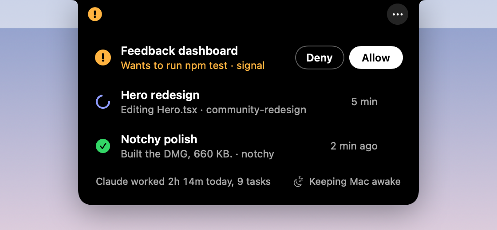

# Notchy

A status light for Claude Code in your MacBook's notch.



- **Working:** a spinner, with what Claude is doing right now ("Editing Hero.tsx", "Reading 3 files"). Each project keeps its own color.
- **Needs you:** an amber "!" and a soft sound. **Allow** or **Deny** right from the notch.
- **Done:** a green check and a chime, with Claude's last line.
- Click a session to open that exact chat. Hover the notch or press **Control-Option-N** to see them all.
- Keeps your Mac awake until Claude is done.

Everything stays on your Mac. No account, no network, no Claude tokens.

[Watch the 30 second demo](docs/notchy-demo.mp4) · [Install and usage guide](docs/index.html)

> Notchy is an independent, personal project. It is not made, endorsed or supported by Anthropic. Claude and Claude Code are trademarks of Anthropic, used here only to say what Notchy works with.

## Install

1. Download **Notchy.dmg** from the [latest release](../../releases/latest).
2. Open it and drag Notchy onto Applications.
3. Open Notchy. The first time, macOS says it can't check the app, because it isn't signed with an Apple Developer ID. Open **System Settings, Privacy & Security**, scroll down and click **Open Anyway**.
4. Click **Connect and show me**. Notchy adds a few small hooks to `~/.claude/settings.json` and saves a backup next to it.
5. Start a new Claude Code chat. It shows up in the notch.

macOS 14 or later, Apple silicon and Intel. On a Mac without a notch, it sits in the middle of the menu bar.

The full guide (everyday use, settings, troubleshooting, privacy, removing it) is in [docs/index.html](docs/index.html).

## Build it yourself

You need the Xcode Command Line Tools (`xcode-select --install`).

```bash
./build.sh --install        # build, copy to ~/Applications and open
./build.sh --dmg            # also make build/Notchy.dmg
```

No Xcode project: `build.sh` compiles `Sources/` with `swiftc` into a universal app and draws its own icon. To sign with a Developer ID, set `NOTCHY_SIGN_ID` to the certificate name before building.

## How it works

Claude Code runs `Notchy hook` on seven events: prompt sent, before and after each tool, permission request, notification, stop and session end. The hook writes one small JSON file per session to `~/Library/Application Support/Notchy/sessions`. The app reads that folder twice a second and draws the island.

For a permission request, the hook waits up to 2 minutes for Allow or Deny from the notch. It steps aside, so Claude's own dialog takes over, when you're already in the app Claude runs in, when you answer in Claude first, when you click the chat in the island, or when the 2 minutes pass.

Other commands: `Notchy demo` plays a demo, `Notchy snapshot <folder>` renders the island states to PNGs, `Notchy icon <file>` draws the app icon.

The demo video is made from `demo/index.html`, an HTML replica of the island with a scripted story: `python3 demo/record.py` renders it to MP4 (needs Playwright and ffmpeg).

## Limits

- Keeping the Mac awake stops idle sleep. Closing the lid still sleeps the Mac unless it's connected to a display.
- Focus modes aren't detected, because macOS keeps them private. Calls are detected through the microphone instead.
- Clicking a terminal session brings the terminal forward, not the exact tab.
- Notchy relies on Claude Code's hooks and on how the Claude app stores its sessions on your Mac. A future Claude update could change that.

## License

MIT. Made by Sergi Font, Product Designer, with Claude Code.
